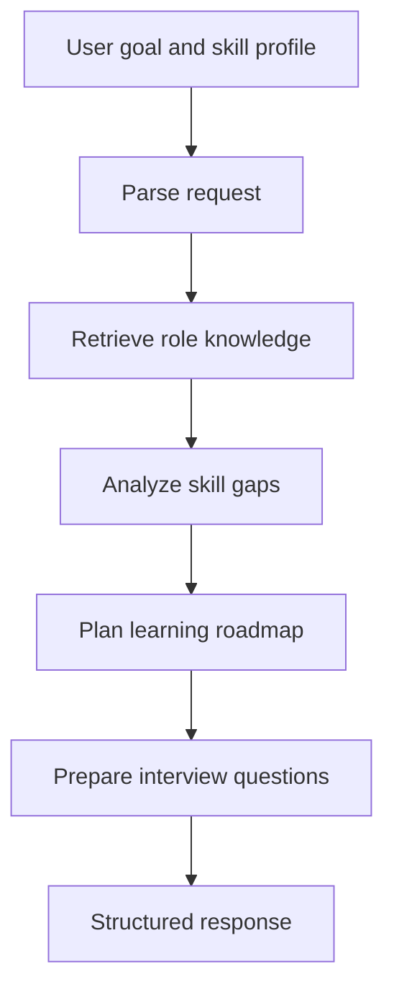

# CareerPilot AI — Skill-Gap Analysis and Interview Preparation

CareerPilot AI is an LLM-assisted career-planning prototype. It takes a target role, a user's current skills, and available time, then builds a skill-gap analysis, a learning roadmap, and role-specific interview questions.

The backend is implemented in Python with FastAPI and LangGraph. It uses a small role-knowledge collection with an in-memory vector store and Google Gemini for selected language and embedding steps.

## Features

- Parses career goals and available study time.
- Retrieves role-related guidance from the included knowledge base.
- Compares declared skills with role requirements.
- Creates a prioritized roadmap based on missing skills and available time.
- Generates role-specific interview questions.
- Exposes the workflow and supported roles through REST endpoints.
- Includes deterministic fallbacks for selected parsing/planning paths.

## Architecture



## Technology

- Python
- FastAPI
- LangGraph and LangChain
- LangServe
- Google Gemini (generation and embeddings)
- In-memory vector store

## Run locally

### Prerequisites

- Python 3.9 or newer
- A Google Gemini API key

### Install

```bash
git clone https://github.com/vidwansai66/careerpilot-ai.git
cd careerpilot-ai
python -m venv .venv
```

Activate the environment, then install dependencies:

```bash
# Windows PowerShell
.venv\Scripts\Activate.ps1

# macOS / Linux
source .venv/bin/activate

pip install -r requirements.txt
```

Set your key in the shell before starting the server:

```bash
# Windows PowerShell
$env:GEMINI_API_KEY="your-gemini-api-key"

# macOS / Linux
export GEMINI_API_KEY="your-gemini-api-key"
```

Start the API:

```bash
uvicorn app:app --reload
```

Useful local routes:

- [Web interface](http://127.0.0.1:8000/)
- [Health check](http://127.0.0.1:8000/health)
- [Supported roles](http://127.0.0.1:8000/roles)
- [Architecture response](http://127.0.0.1:8000/architecture)
- [Interactive LangServe playground](http://127.0.0.1:8000/careerpilot/playground/)

OpenAPI docs are available at [http://127.0.0.1:8000/docs](http://127.0.0.1:8000/docs).

## Configuration and limitations

- The Gemini key is required for LLM/embedding operations; quota and provider availability can affect those steps.
- Deterministic fallbacks cover selected logic; they do not guarantee all generated content is factually correct.
- The included role knowledge base is curated and is not a live job-market feed. Validate roadmaps against current job descriptions.
- Treat this as an educational prototype until tests, evaluation cases, and deployment instructions are maintained.
